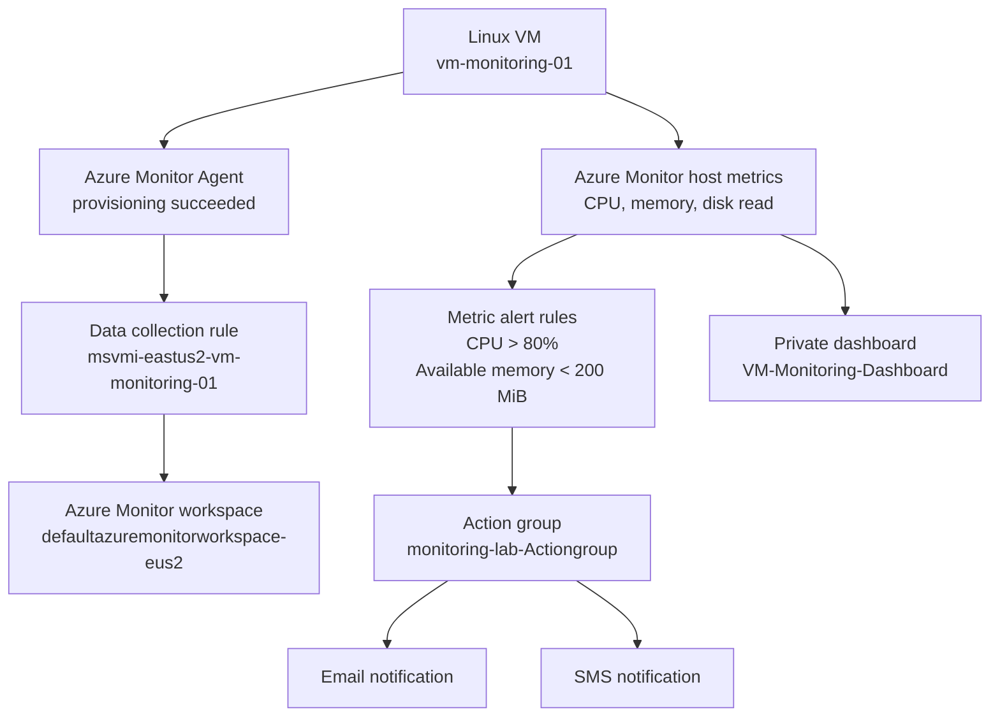

# Azure VM Monitoring and Alerting Lab

A portal-first Azure Monitor lab built to demonstrate infrastructure monitoring, metric-based alerting, notification delivery, and dashboarding for a Linux virtual machine.

## Project status

**Core monitoring and alert delivery validated.** An email and SMS were received from the configured action group.

Verified in the Azure portal:
- Linux VM: `vm-monitoring-01`
- Resource group: `rg-azure-monitoring-lab`
- Region: `East US 2`
- Azure Monitor Agent extension: `AzureMonitorLinuxAgent`, provisioning succeeded
- Data collection rule: `msvmi-eastus2-vm-monitoring-01`
- Azure Monitor workspace: `defaultazuremonitorworkspace-eus2`
- Action group: `monitoring-lab-Actiongroup` with one email and one SMS action
- CPU alert rule: `alert-vm-monitoring-01-high-cpu`, condition `Percentage CPU > 80`, enabled
- Low-memory alert rule: `alert-vm-monitoring-01-low-memory`, condition `Available Memory Bytes < 209715200 bytes` (200 MiB), with a 5-minute lookback
- Private Azure dashboard: `VM-Monitoring-Dashboard`
- Dashboard charts confirmed: Average Percentage CPU, Average Available Memory Bytes, Sum Disk Read Bytes

The CPU and memory alert rules were configured with evaluation every 1 minute and a 5-minute lookback. The CPU rule uses the `Average` aggregation. The low-memory rule uses `Average` aggregation and Warning severity. The CPU rule was shown as Informational severity in the alert rules list.

**Not claimed as verified:** Disk Write Bytes was the next planned dashboard chart, but its successful addition was not confirmed in the final screenshot. The data collection rule's Data sources page showed `Otel Performance Counters`; the portal displayed `Unsupported` in its Transform column. Review this if expanding collection beyond the currently verified metrics.

## Architecture

> The diagram represents the configured lab at a conceptual level. Azure Monitor platform metrics and guest-level data collection are separate paths; validate each metric source in the portal.

## Repository contents

- `docs/architecture.md`: architecture and design notes
- `docs/deployment-record.md`: verified resource inventory and implementation record
- `docs/alerts.md`: alert conditions and notification configuration
- `queries/monitoring.kql`: starter KQL queries for a Log Analytics workspace, where the relevant tables are being collected
- `screenshots/README.md`: guidance for adding sanitized evidence screenshots

## Reproduce or review the lab

1. Create a resource group in a single region.
2. Deploy a Linux VM with SSH key authentication and restrict inbound SSH to your own trusted IP.
3. Enable Azure Monitor infrastructure monitoring for the VM and configure the Azure Monitor Agent and data collection rule.
4. Confirm the agent extension reports provisioning succeeded.
5. Create an action group with email and SMS actions. Use test notifications where supported.
6. Create metric alert rules for CPU and available memory.
7. Create a dashboard and pin the VM CPU, memory, and disk metrics.
8. Trigger or wait for a condition that crosses a threshold and confirm delivery.
9. Review costs, retention, alert noise, and access before leaving the lab running.

Exact portal options can change over time. This repository documents the configuration that was verified in this lab, not a guaranteed one-click deployment template.

## Security and cost notes

- Do not commit private SSH keys, passwords, access tokens, subscription IDs, tenant IDs, personal phone numbers, or unredacted portal screenshots.
- Use SSH keys rather than enabling password SSH login for a public-facing VM.
- Restrict network access and remove public exposure if it is not required.
- Azure Monitor, Log Analytics ingestion/retention, alerts, and VM compute/storage may incur charges. Review Cost Management before leaving resources running.
- This lab is configured in `East US 2`; your own deployment may have different prices, availability, and naming constraints.

## Evidence and validation

The user confirmed receiving both SMS and email notifications. The Azure portal showed the CPU alert rule as enabled. The dashboard screenshot showed CPU, available memory, and disk read charts.

For a public portfolio repository, add sanitized screenshots showing:
- Dashboard with the metric charts
- Enabled alert rules and conditions
- Action group action types, with recipients obscured
- Azure Monitor Agent provisioning status

Do not upload screenshots that reveal account email addresses, subscription identifiers, phone numbers, IP addresses, or other sensitive details.
